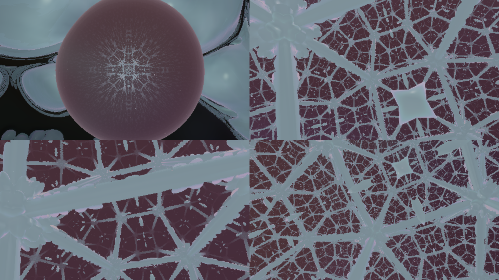

# Not Kansas



*Headless software render: top left, the moon from outside; the rest, inside the hyperbolic ball.*

The inside of the moon is hyperbolic space.

This is [CrystalMoonV2](https://github.com/anttiluode/CrystalMoonV2) (two-scale crystal, moonlight that bends and writes, the moon as a membrane between two worlds, glass, your camera) with one change. Fly into the moon and you are no longer in an inverted copy of a world. You are in a Poincaré ball:

- **The wall is infinitely far away.** Fly toward it and it keeps receding; the HUD shows your hyperbolic distance from the centre, which grows without limit while you stay inside a sphere of radius 9.
- **Light travels on hyperbolic geodesics:** circular arcs that meet the wall at right angles. Flying forward bends your view along the same arcs.
- **Space is tiled by cubes that flat space cannot hold.** Five cubes meet around every edge (dihedral angle 72° instead of 90°). The tiling is the order-5 cubic honeycomb {4,3,5}. Its cubes are all the same size in hyperbolic distance, so toward the wall they shrink and multiply without end, a three-dimensional *Circle Limit*.
- **The honeycomb's frame is drawn in crystal.** Struts run along every cube edge and knots sit at the corners, all the same thickness in hyperbolic distance, so you can see the cubes multiply (slider *the honeycomb's frame*, 0 removes it).
- **The crystal is alive in every cube.** Each cube shows the growing crystal of the world inside the moon, folded in by the honeycomb's mirrors. The colour shifts with the number of cube walls between you and it.
- **The wall at infinity is the boundary of the universe.** With your camera on, it is your picture.

One HTML page, WebGL2, no libraries. **Live:** https://anttiluode.github.io/NotKansas/

**Keys:** W A S D fly · R F up/down · Q E roll · Shift fast · mouse look (click to capture) · M face the moon · V camera · **X** leave the moon · **K** switch the inside between hyperbolic and V2's inversion (which keeps V2's descent through the levels).

## The mathematics

**The ball.** Inside the moon, in units of its radius, the metric is ds = 2|dx| / (1 − r²). A step of hyperbolic length h is a Euclidean step h(1 − r²)/2, so the distance to the wall, 2 artanh(r), is infinite.

**Rays.** Hyperbolic geodesics are the light rays of a medium with refractive index n = 2/(1 − r²) (Fermat's principle in the conformal metric). CrystalMoon's renderer already bends rays with d(n d̂)/ds = ∇n, so the inside needed no new optics. With ∇ ln n = 2x/(1 − r²) and a Euclidean step h(1 − r²)/2, the update per hyperbolic step is just

```
d ← normalise(d + h (x − (x·d) d)),      x ← x + d · h (1 − r²)/2
```

**The honeycomb.** The central cube's six faces are spheres meeting the wall at right angles. The +x face is centred at (c, 0, 0) with radius ρ, where

```
ρ² = 1 + √5,     c² = 2 + √5 = 1 + ρ²
```

(the second equation is the right angle with the wall). With these numbers, two neighbouring faces meet at 72°, the cube's inradius is 0.5306 and its circumradius 1.2265 in hyperbolic distance, the known values for {4,3,5}.

**The fold.** To find what is at a point x, it is reflected into one chamber of the central cube (x ≥ y ≥ z ≥ 0): taking absolute values and sorting the coordinates are the cube's own mirrors, and inverting in the face sphere is a hyperbolic reflection into the neighbouring cube. Repeat until nothing changes. The number of inversions k is how many cube walls lie between x and the centre. The crystal shown at x is the inner world's crystal at a point of a chunk of it, `island + fold(x)·40` voxels (the *crystal per cube* slider sets the 40).

Because the fold uses mirrors, every cube shows the same chunk of crystal reflected 48 ways: what you see in any cube is the living field, kaleidoscoped.

**The group.** The mirrors generate the Coxeter group [4,3,5]. It acts on hyperbolic space with a compact fundamental domain, so it is word-hyperbolic. That is the class of groups in Mghirbi and Douglas's [Kaplansky paper](https://arxiv.org/abs/2611.04599) (Nov 2026). But this one has torsion (it is made of reflections), it is not one of their groups, and nothing here involves their mod-p cancellation. The connection is the geometry, not the counterexample.


## Kaplansky's Crystal: the counterexample you can watch

**[kaplansky.html](https://anttiluode.github.io/NotKansas/kaplansky.html)** (a separate page; the world above is unchanged).

Giles Gardam's 2021 counterexample to Kaplansky's unit conjecture, computed exactly and shown in the space it acts on. The group is the Hantzsche–Wendt group, a torsion-free crystal group generated by two screw motions of ordinary space:

```
a(v) = (x + ½, ½ − y, −z),     b(v) = (−x, y + ½, ½ − z),     x = a², y = b², z = (ab)²
α  = p + q a + r b + s ab,     p = (1 + x)(1 + y)(1 + z⁻¹),   q = x⁻¹y⁻¹ + x + y⁻¹z + z,
                               r = 1 + x + y⁻¹z + xyz,         s = 1 + (x + x⁻¹ + y + y⁻¹) z⁻¹
α′ = x⁻¹ pᵃ + x⁻¹ q a + y⁻¹ r b + z⁻¹ sᵃ ab                    (coefficients in F₂, ηᵃ = a⁻¹ η a)
```

Every dot is one group element, drawn where it carries a fixed point o, with an arrow showing which way it turns space. The 21 × 21 = 441 products of α and α′ fly to their places, pile up on 121 group elements, and cancel in pairs (1 + 1 = 0) until only the identity is left. Buttons replay it as α′ · α, over the integers (nothing cancels: 121 terms), and with one term of α′ removed (20 terms survive).

`node tests/kaplansky.test.cjs` (6/6):

| test | result |
|---|---|
| K1 the two affine maps satisfy P's presentation | b⁻¹a²b = a⁻² and a⁻¹b²a = b⁻²; a² and b² are unit translations, z = (ab)² translates by (0, 0, −1) |
| K2 P acts freely (so it is torsion-free) | 363 elements of the ball of radius 7: none fixes a point |
| K3 the unit | \|α\| = \|α′\| = 21; α α′ = α′ α = 1 |
| K4 it needs 1 + 1 = 0 | the 441 products land on 121 elements; 120 are hit an even number of times, the identity 17 times |
| K5 it is not an accident | removing any one term of α′ leaves at least 20 terms |
| K6 α is not a trivial unit | 21 terms |

**What this is, and is not.** This is the *unit* conjecture's counterexample (Gardam 2021, Annals of Mathematics). The 2026 counterexamples to the *zero-divisor* conjecture (OpenAI; Ivanov; Mghirbi & Douglas) live in random hyperbolic groups built from large labelled graphs, far too big to draw like this. And in this crystal group there are no zero divisors at all: it is torsion-free and elementary amenable, where the zero-divisor conjecture is a theorem (Kropholler, Linnell and Moody). The formulas are Gardam's (Theorem A and Lemma 1); the affine form of the group and the multiplication conventions are mine, and the tests are what show they agree.

## Ledger (the hyperbolic moon)

`node tests/kansas.test.cjs` (seconds):

| test | result |
|---|---|
| H1 the central cube: faces meet the wall at right angles, dihedral 72°, in- and circumradius of the {4,3,5} cube | c² − 1 − ρ² = 0; dihedral 72.000000000°; inradius 0.5306375310; circumradius 1.2264568713 |
| H2 fold(): every point lands in one chamber of the central cube, and the fold keeps hyperbolic distances | 4000 points out to hyperbolic radius 4.5: 0 outside; up to 9 cube walls crossed; worst relative distance change 1.8e-8 over 3814 nearby pairs |
| H3 the bent rays are geodesics: each stays on a circle meeting the wall at right angles, and never reaches it | 50 rays × 8 units of hyperbolic length: worst deviation from the circle 3.1e-4 (step size); farthest point r = 0.99966 |

`node tests/core.test.cjs` is CrystalMoonV2's ledger for the crystal, light, membrane and camera (12/12 there). `index.html?selftest` checks that the GPU simulation equals the CPU one; it passes here unchanged (largest difference 6.7e-8).

## What this is not (yet)

- **The crystal does not grow in hyperbolic space.** It grows in the inner world's flat 64³ grid and is folded into the cubes. A crystal that obeys a hyperbolic Laplacian (Laplace–Beltrami on the ball) would grow different patterns; that is a later experiment.
- **The frame is drawn, not grown.** The struts are a fixed shape (distance to the cube edges and corners), shaded like crystal. Only the blobs inside the cubes are the living field.
- **Every cube shows the same crystal.** The honeycomb is generated by mirrors, so the tiling is exact and seamless, but it is a kaleidoscope of one chunk.
- **There is a cutoff.** The cubes become smaller than a pixel near the wall. Past r ≈ 0.93 the crystal fades into the wall's colour, and the march stops at r = 0.985 (hyperbolic distance 4.9 from the centre).
- **It is not lit by the moon.** Inside, the crystal is lit from the wall at infinity (with the inner world's moonlight added).
- **Speed on a real GPU is not measured.** The march inside does up to 28 reflections per sample.
- **Inside, your flight does not change the crystal.** No wake is written while you are in the ball.

## Files

- `index.html`: the world (V2's simulation and renderer, plus `fold`, `hyperView` and the hyperbolic flight)
- `core.js`: V2's laws and CPU reference, plus the honeycomb, `fold`, the hyperbolic distance and the geodesic march
- `kaplansky.html`, `kaplansky.js`: Kaplansky's Crystal (Gardam's unit)
- `tests/kansas.test.cjs`, `tests/core.test.cjs`, `tests/kaplansky.test.cjs`: the ledgers

Built with Claude (Opus 5.5), Saturday 7 November 2026, after a talk with Astra about the new Kaplansky counterexamples, AdS, and what a moon that is infinitely large inside would look like.
